# ShiptGiving

**Birmingham nonprofits post what they need tonight. Neighbors fill it in a few taps, and every pledge is batched into a delivery route sized to tomorrow's drivers.**

[](https://nextjs.org/)
[](https://www.typescriptlang.org/)
[](https://tailwindcss.com/)
[](https://shiptgiving.vercel.app)
[](#tests-and-smoke-check)

**[Open the live demo →](https://shiptgiving.vercel.app)** · [What it does](#what-it-does) · [How it works](#how-it-works) · [Run it locally](#run-it-locally) · [Team](#team-and-roles)

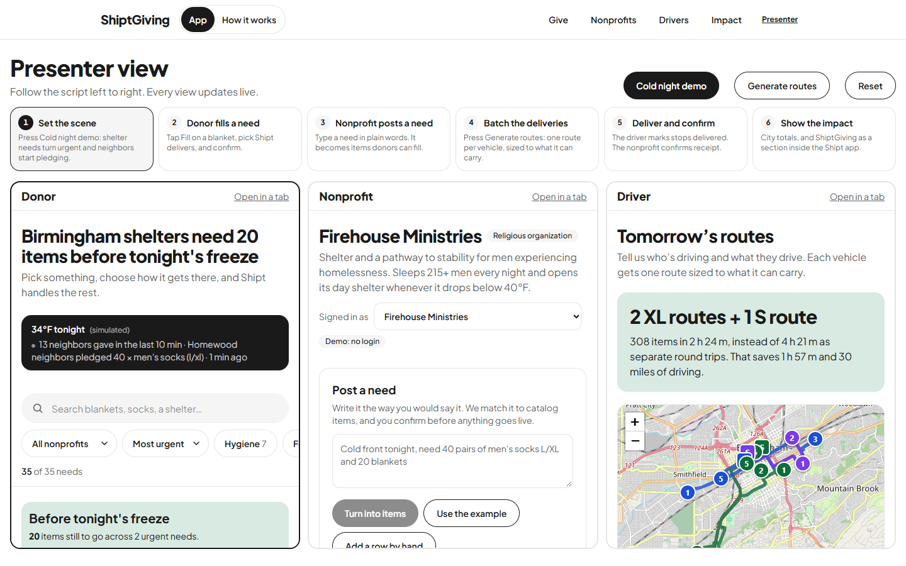

Built in about 4.5 hours at SHIPT Hacks 2026 in Birmingham, AL (theme: "Build a Better Birmingham") by team 404 Not Foundries, three students from the University of Alabama at Birmingham (UAB).

> [!NOTE]
> ShiptGiving is a hackathon concept. It is not affiliated with or endorsed by Shipt. There is no real Shipt API integration: the "Shipt delivers" checkout and the platform order payload are mocks, and no payment is ever taken.

## The problem

Birmingham's nonprofits run on donated goods, and the need is large:

- **Firehouse Ministries** shelters 215+ men every night (29,509 shelter nights in 2025) and collects clothing and toiletries through a static wish list. It opens its day shelter on any day under 40°F or with a heat advisory. ([site](https://firehouseshelter.com/), [FAQ](https://firehouseshelter.com/who-we-are/faq/))
- About **146,000 Birmingham residents live in food deserts**, while Jones Valley Teaching Farm gives away everything it grows at one walk-up stand in a narrow weekly window. ([Bham Now](https://bhamnow.com/2024/11/14/how-to-find-healthy-food-in-birminghams-food-insecure-neighborhoods/))
- **Birmingham Promise** is growing from 50 to about 100 interns per semester plus 400 job shadowers, and its scholarship doesn't cover housing, meals or transportation. ([news](https://birminghampromise.org/?p=476), [FAQ](https://birminghampromise.org/about/faq/))

Giving goods is still hard. You buy the item, find the drop-off hours, drive downtown and hope it is still needed. Nonprofits end up with 60 of one thing and none of what they asked for, and every donor makes a separate trip.

ShiptGiving turns a wish list into a live feed, lets anyone fill a line of it in a few taps, and batches the deliveries. It is seeded with 11 real Birmingham nonprofits (shelters, the food bank, education partners) with their real locations, receiving hours and accept rules. Hours a partner hasn't published are marked as assumed.

## What it does

ShiptGiving is one web app with three roles (donor, nonprofit, driver) that all read the same live state. A pledge made in one window shows up in the others within two seconds.

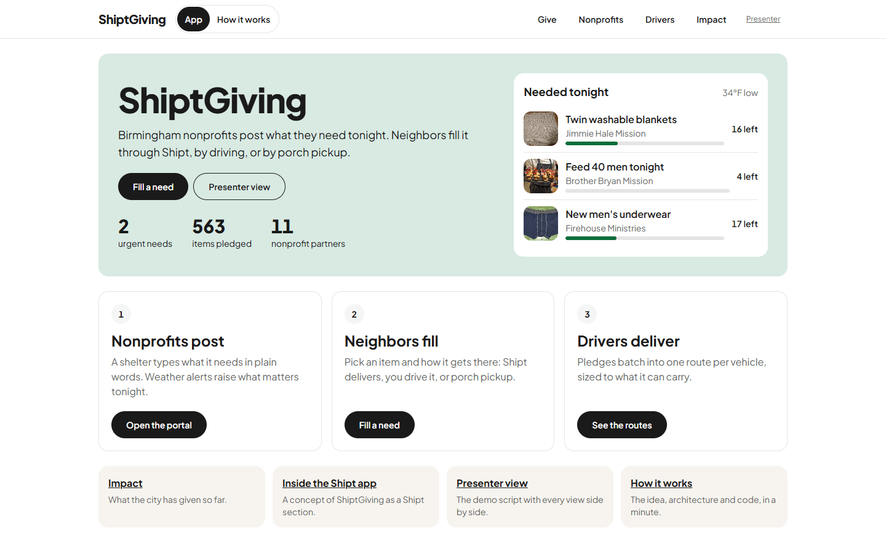

### Donor feed

The `/give` feed puts tonight's most urgent needs first, as photo cards with progress bars, search, category filters, a partner filter and sort. A live strip shows the weather and the latest pledges, and each card shows which neighbors are already helping. Every partner also has its own page at `/p/[id]`.

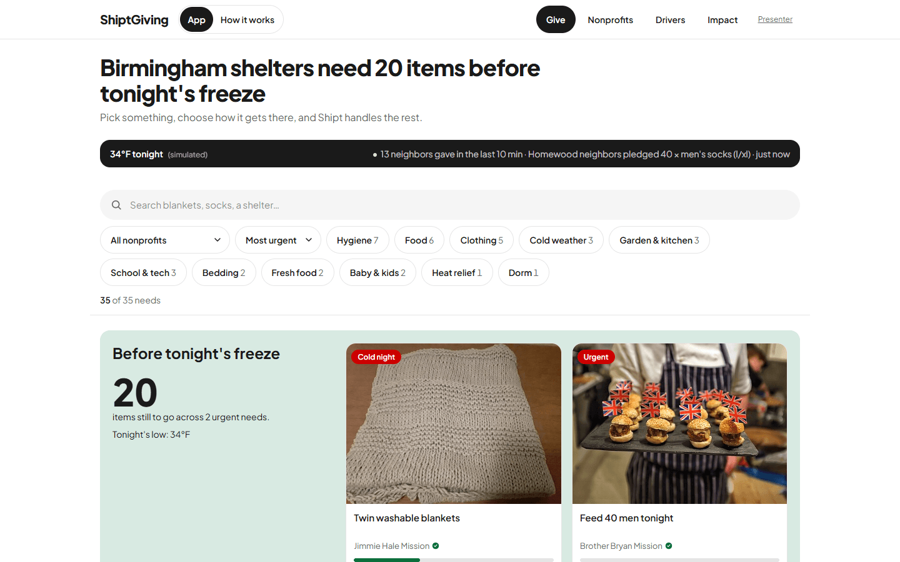

### Three ways to give, one shared delivery fee

Tapping **Fill** opens a three-step sheet (quantity, delivery, confirm) with three ways to get the items there:

- **Shipt delivers**: buy it from a nearby store (closest to the drop-off first) as an ordinary gift order addressed to the nonprofit.
- **I'll drive it**: bring items you own or buy yourself. No fees.
- **Porch pickup**: leave new or sealed items on your porch and a batched driver collects them.

Delivery is a single $9.99 community-batch fee split across every donor in the same batch, so each share shrinks as more neighbors join. Shipt orders add a 5% service fee; porch donors pay only their delivery share. The sheet warns when a pledge is more than tomorrow's drivers can carry.

| Delivery step | Confirm step with the shared fee |
|---|---|
| 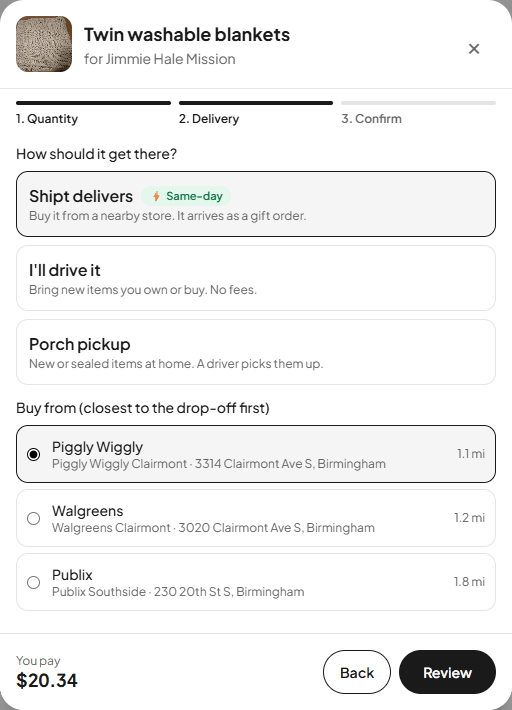 | 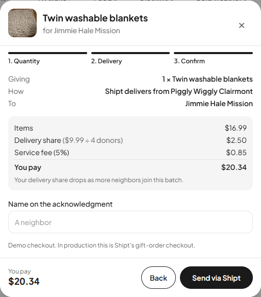 |

### Nonprofits post needs in plain English

Shelter staff type a need the way they would say it: *"Cold front tonight, need 40 pairs of men's socks L/XL and 20 blankets."* Claude turns it into catalog items, converts units (40 pairs from 6-packs becomes 7 packs) and flags urgency. Staff check the rows and publish.

The model must answer in a JSON schema whose item ids are an enum of the real catalog, and anything else is dropped. With no API key, or if the call fails, a keyword parser takes over so the portal keeps working offline.

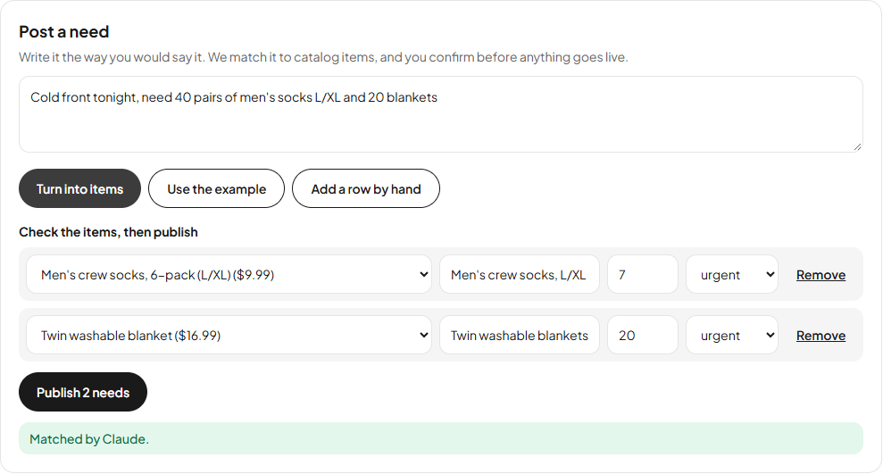

### Cold-night Weather Surge

The app reads tonight's forecast from the National Weather Service. A low under 40°F, or an active heat advisory, makes cold-weather or heat-relief items urgent at shelters that opt in, and the reason ("Tonight's low: 34°F") follows the need onto the donor feed. When the weather turns, each need returns to the urgency it had before. For a live demo, the surge can be simulated from the portal.

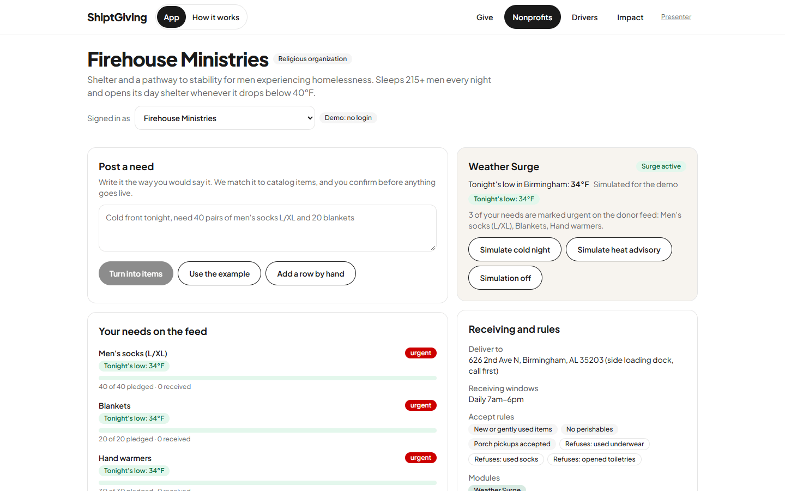

### IRS-verified partners and confidential addresses

Each partner is checked automatically against IRS exempt-organization records on ProPublica: its employer identification number (EIN), 501(c)(3) status, legal name and city. The check re-runs live on the server with a 10-minute cache and falls back to the last known result if ProPublica is slow. Churches, which don't have to register with the IRS, are shown as religious organizations instead of failing.

Shelters that must keep their location private, such as Pathways and the YWCA's domestic violence shelter, are marked confidential. Their real address never reaches a donor, a driver or the Shipt order payload: every delivery goes to a public drop point, and a confidential partner without one is never routed. Unit tests check that the address is never rendered or sent.

| Confidential shelter | Automated verification |
|---|---|
| 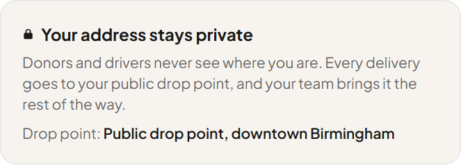 | 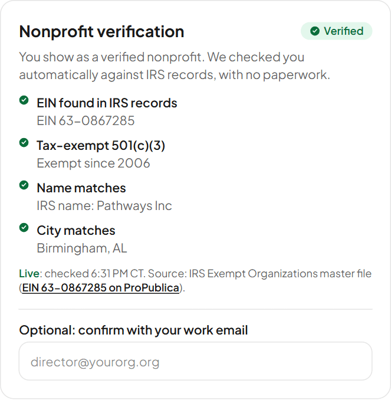 |

### Fleet routing sized to the vehicle

The driver view lists tomorrow's drivers and what they drive. **Generate routes** gives every vehicle one route sized to its capacity (S compact 10 items, M sedan 25, L SUV 50, XL school bus 150), drawn on the map with road lines, plus a banner with the time and miles saved against separate round trips. The demo fleet is two school buses and a convertible, and the cold-night pledges come out as **2 XL routes + 1 S route: 308 items in 2 h 24 m instead of 4 h 21 m**, saving 1 h 57 m and 30 miles of driving. [How the routing works](#the-routing-algorithm).

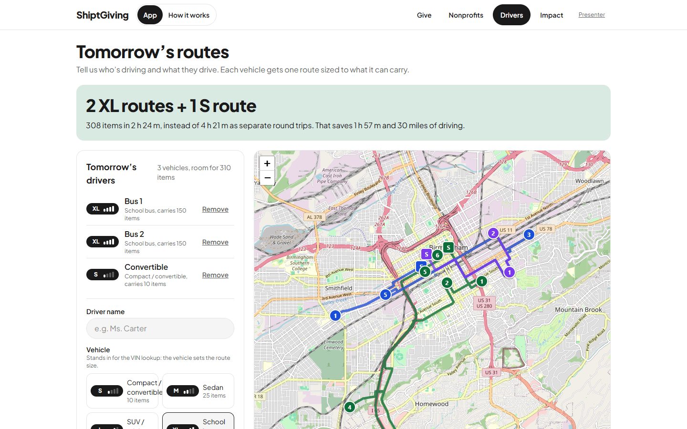

Route cards list every stop in order with estimated arrival times from a 9:00 AM start, each partner's receiving window, a late badge if a drop-off falls outside it, and **Mark picked up** / **Mark delivered**.

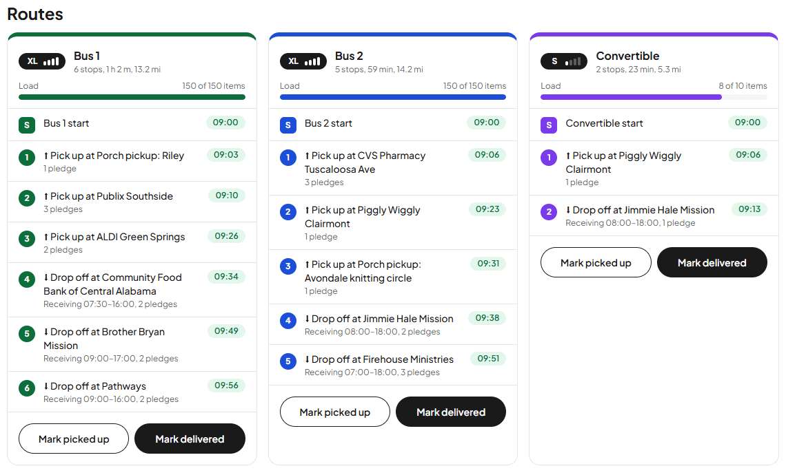

### Impact across the city

The Impact page shows city totals (items pledged and delivered, partners helped, donors, value of goods), trips, minutes and miles saved by routing, progress per partner and recent activity. Delivered items only count once the partner confirms receipt.

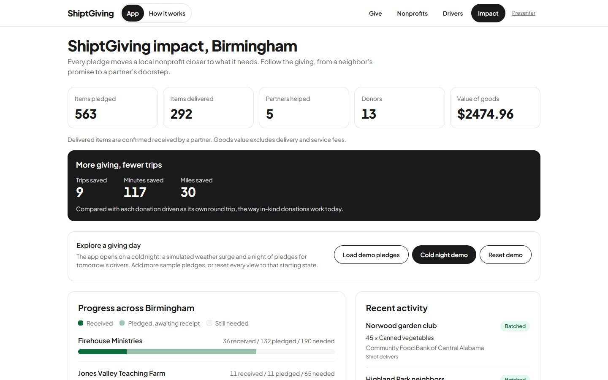

### Inside the Shipt app (concept)

What ShiptGiving could look like as a section of the Shipt app: neighborhood stores, tonight's urgent needs and your community orders. Each order has a tracking page that follows the pledge as the driver and partner update it, with a cost breakdown and a developer view of the gift-order payload a platform integration would send. A pledge is shaped as a gift order on purpose: Shipt already delivers gifts to any address, so no new order type, labor model or money handling would be needed.

| Shipt section | Order tracking and platform payload |
|---|---|
| 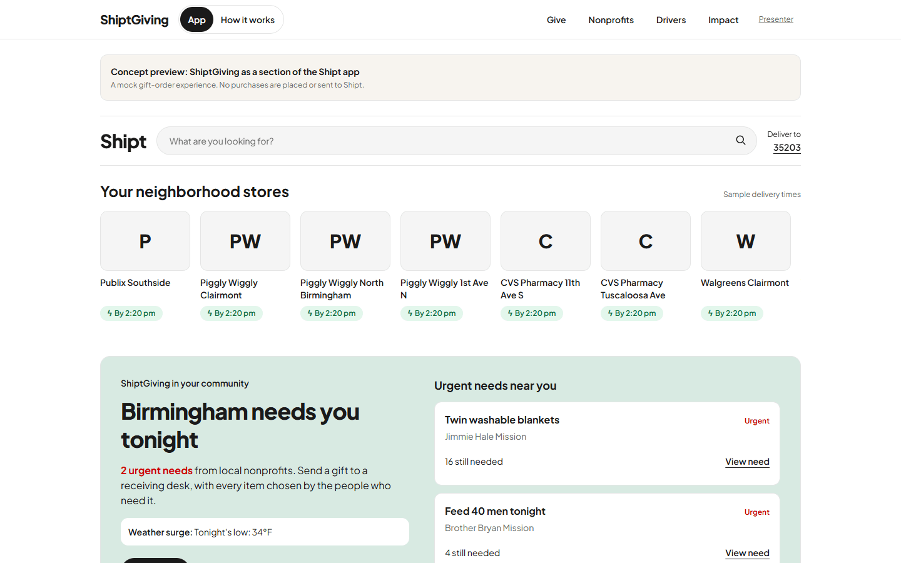 | 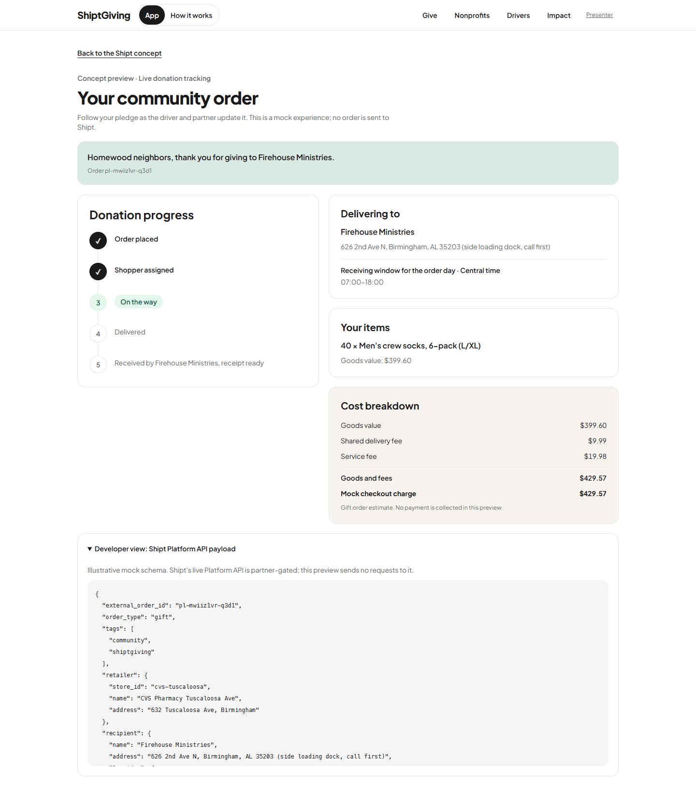 |

### Presenter view

`/demo` (the image at the top) puts donor, nonprofit and driver side by side on one screen with a six-step demo script and **Cold night demo**, **Generate routes** and **Reset** buttons. The app also starts in that cold-night state, so it never opens empty.

### The How it works page

`/how-it-works` walks through the features, a pledge's flow, the architecture, a code map with key excerpts, and the tech decisions, inside the app itself.

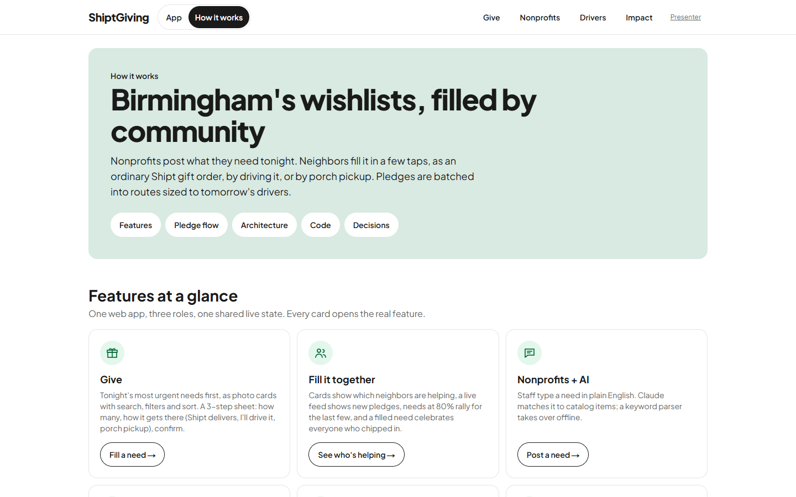

### On a phone

Every view works at phone width, with 44 px tap targets. The driver view puts the map first.

<p>
  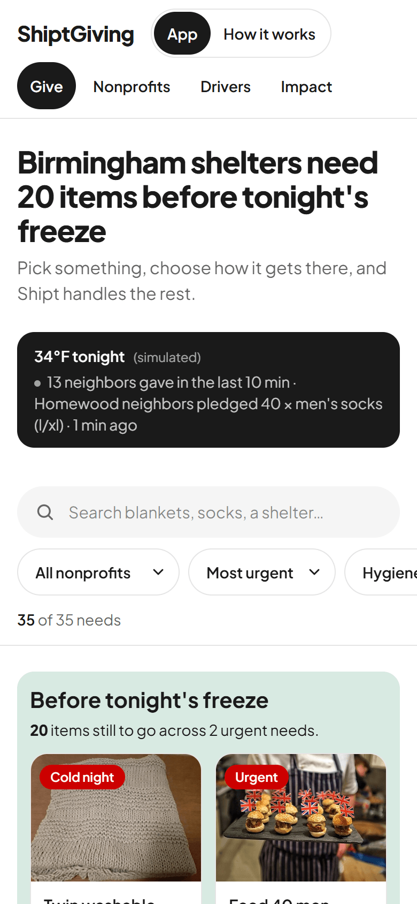
  &nbsp;&nbsp;
  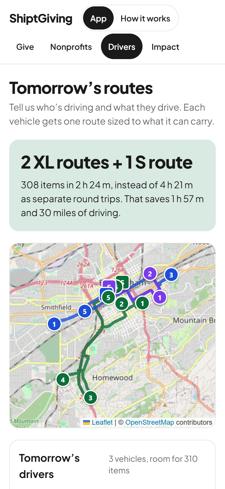
</p>

## How it works

This section covers the architecture, the life of one pledge, and the routing algorithm.

### Architecture

One Next.js App Router app. Pages are client components that poll a single state endpoint; every write goes through a route handler that validates input and commits a new state object to an in-memory store. Every external call has a timeout and a fallback, so the demo survives a bad network.

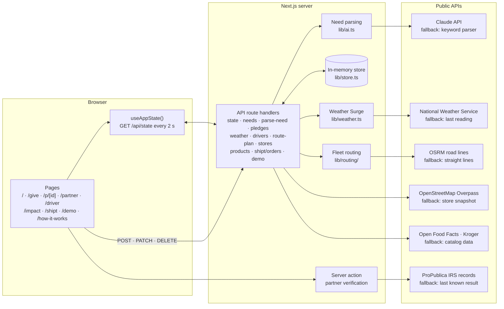

- **Shared contract**: Pages and API routes share `src/lib/types.ts`, so a contract change breaks the build, not the demo.
- **In-memory store + 2 s polling**: One Node process holds all state, with no database and no websockets, which is enough for a one-laptop demo. Every write returns a new state object, so swapping in a database is the path to scale.
- **Start state**: `src/instrumentation.ts` loads the cold-night scenario when the server starts.

### A pledge's lifecycle

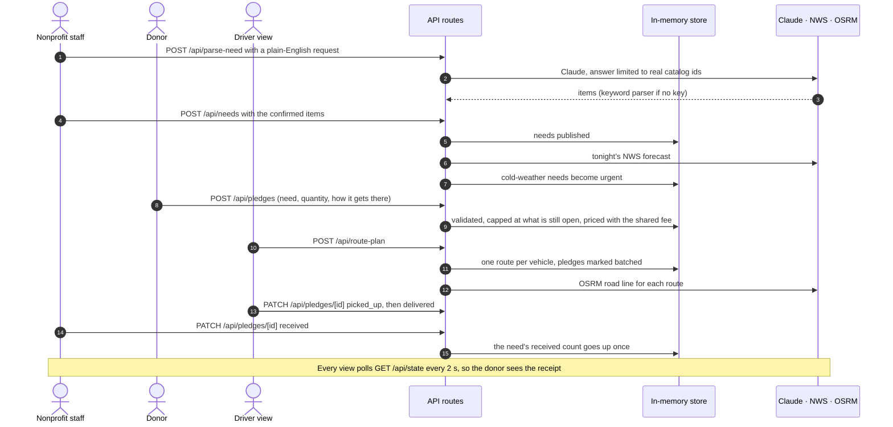

### The routing algorithm

The planner in [`src/lib/routing/`](shiptgiving/src/lib/routing) is greedy and small on purpose: it runs in milliseconds on tens of stops, needs no API key, is unit-tested, and every decision can be explained in one sentence.

1. **What gets routed**: Open "Shipt delivers" and porch-pickup pledges, grouped by nonprofit. Volunteers drive their own.
2. **Biggest vehicle first**: Drivers are sorted by capacity. Each one takes nonprofits in order of earliest closing time, then distance from the driver's start, loading pledges while they fit. A pledge bigger than the largest vehicle is split across vehicles; whatever the fleet can't carry is reported, and the donor sheet warns about it up front.
3. **Shop, then deliver**: Each route visits all its pickups (the chosen store, the store nearest the nonprofit, or a donor's porch), then all its drop-offs, so every pickup comes before its drop-off. Stops at the same place are merged.
4. **Nearest neighbor + 2-opt**: Each phase is ordered by nearest neighbor, then improved with 2-opt: reverse any stretch of the path that makes it shorter.
5. **Times**: Straight-line distance × 1.3 at 25 mph, plus 5 minutes per stop for parking and hand-off. A drop-off outside the partner's receiving hours counts as late. OSRM only draws the road line on the map.
6. **Baseline**: Each donation as its own round trip, the way in-kind giving works today (start → store → nonprofit → back, or home → nonprofit → home for a porch donor), with the same distance model and stop time. The saving comes from shared trips and merged stops.

On the demo night that gives **2 XL routes + 1 S route: 308 items in 2 h 24 m instead of 4 h 21 m**. The two buses leave full (150 of 150 items each) and the convertible carries the last 8. Known limits are listed in the [developer README](shiptgiving/README.md#how-the-routing-works).

## Tech stack

The whole app is one TypeScript codebase with no database:

| Layer | Choice |
|---|---|
| Framework | [Next.js 16](https://nextjs.org/) (App Router, route handlers, a server action, `instrumentation.ts`), [React 19](https://react.dev/) |
| Language | [TypeScript 5](https://www.typescriptlang.org/), strict |
| Styling | [Tailwind CSS v4](https://tailwindcss.com/) with Shipt-inspired design tokens, [Plus Jakarta Sans](https://fonts.google.com/specimen/Plus+Jakarta+Sans) |
| Maps | [Leaflet](https://leafletjs.com/) + [react-leaflet](https://react-leaflet.js.org/), OpenStreetMap tiles |
| AI | [Anthropic SDK](https://github.com/anthropics/anthropic-sdk-typescript), Claude with JSON-schema output, keyword fallback |
| State | In-memory store on `globalThis`, 2-second polling |
| Tests | [Vitest](https://vitest.dev/) (121 tests) and a 26-step end-to-end smoke script |
| Hosting | [Vercel](https://vercel.com/), deployed with the Vercel CLI |

## Public data and APIs

Every source below has a timeout and a fallback, and only Claude needs a key:

| Source | Used for | Key needed |
|---|---|---|
| [OpenStreetMap Overpass](https://wiki.openstreetmap.org/wiki/Overpass_API) (+ Nominatim snapshot) | Real Birmingham grocery and pharmacy stores as pickup points | No |
| [National Weather Service](https://www.weather.gov/documentation/services-web-api) | Tonight's low and heat alerts for the Weather Surge | No |
| [Open Source Routing Machine (OSRM)](https://project-osrm.org/) public server | The road line drawn for each route | No |
| [ProPublica Nonprofit Explorer](https://projects.propublica.org/nonprofits/api) | IRS records for partner verification | No |
| [Open Food Facts](https://world.openfoodfacts.org/) | Food product names, brands and photos | No |
| [Kroger Developer API](https://developer.kroger.com/) | Live shelf prices (optional) | Free account |
| [Claude API](https://docs.anthropic.com/) | Parsing plain-English needs | Yes, with a keyword fallback |

## Project structure

The app lives in `shiptgiving/`; the root holds this README and its screenshots:

```text
.
├── docs/images/              README screenshots
└── shiptgiving/              the Next.js app
    ├── scripts/smoke.mjs     end-to-end check against a running server
    └── src/
        ├── app/              pages (/, give, p/[id], partner, driver, impact, shipt, demo, how-it-works)
        │   └── api/          route handlers: read JSON, call one store function, return JSON
        ├── components/       donor/, partner/, driver/, impact/, shipt/, explain/, nav/, ui/
        ├── data/             11 partners, 50 catalog items, 35 needs, IRS records
        └── lib/
            ├── types.ts      the shared data contract
            ├── store.ts      in-memory state and every validated write
            ├── routing/      assign.ts (who carries what), order.ts (stop order, ETAs, baseline)
            ├── ai.ts         Claude need parsing + keyword fallback
            ├── weather.ts    NWS forecast and the surge rule
            ├── fees.ts       the shared delivery fee
            ├── shipt-platform.ts   a pledge as a Shipt gift order (mock)
            └── demo.ts       the cold-night scenario
```

## Run it locally

Requires Node.js 20+.

```bash
cd shiptgiving
npm install
npm run dev          # http://localhost:3000
```

No key is required. To let Claude parse needs, copy `.env.example` to `.env.local` and set `ANTHROPIC_API_KEY`; without it, parsing uses the keyword fallback. Kroger keys are optional and add live shelf prices. The [developer README](shiptgiving/README.md) has the API routes, a 60-second demo script and the routing details.

## Tests and smoke check

```bash
cd shiptgiving
npm test             # 121 Vitest tests in 17 files
npx tsc --noEmit     # type check
npm run smoke        # with the dev server running: 26 end-to-end checks
```

The unit tests cover routing (capacity, biggest vehicle first, spill-over, pickups before drop-offs, the baseline, late stops, oversized splits, drop points), store validation and over-pledge refusal, the fee split, the AI keyword parser, the surge rule, the Shipt payload (confidential addresses never exposed), IRS verification with its cache and fallback, and the cold-night scenario. The smoke script drives the whole flow against a running server, from posting a need to confirming receipt, then restores the demo state.

## Deployment on Vercel

The live demo runs on Vercel at **[shiptgiving.vercel.app](https://shiptgiving.vercel.app)**. It is deployed by hand with the Vercel CLI from `shiptgiving/`, not on every merge, so the demo couldn't change in the middle of a presentation. State lives in memory, so the live site is a shared sandbox: each server instance starts in the cold-night scenario, and changes last until it restarts.

## Team and roles

404 Not Foundries is three UAB students:

- **[Rodion Mayatskiy (@rmaytr)](https://github.com/rmaytr)**, team lead
  - Scaffolded the app: the shared types, the in-memory store and the core API routes
  - Designed and built the fleet routing (vehicle sizes, greedy assignment, shop-then-deliver ordering with 2-opt, the round-trip baseline, oversized-pledge splits) and the driver view with the map and route cards
  - Built the cold-night demo scenario, the presenter view, the home hub, the Impact page and the `/how-it-works` walkthrough
  - Built the Shipt integration concept (the Shipt section, order tracking, the gift-order payload) and brought in the Shipt design language
  - Ran the team's agent workflow, added the smoke check and deployed to Vercel
- **[@mulimangila](https://github.com/mulimangila)**
  - Built the donor experience: the needs feed, the fill-a-need sheet and the partner pages
  - Designed the donor fees, including the delivery fee shared across a batch
  - Built "Fill it together" (which neighbors are helping, rallies for the last few items, a celebration when a need is filled)
  - Redesigned the feed in the Shipt style and added verified-nonprofit badges and order tracking links
- **[@Viral-W](https://github.com/Viral-W)**
  - Researched and built the seed data: 11 real Birmingham nonprofits with their hours and accept rules, the catalog and the needs
  - Built the nonprofit portal: post a need, the incoming board, confirm receipt, dorm kits and confidential badges
  - Built AI need parsing with Claude and the keyword fallback
  - Built the NWS Weather Surge and automated IRS verification through ProPublica, including religious-exempt status
  - Brought the Shipt mentors' feedback on routing and vehicle sizes into the plan

## Built at SHIPT Hacks 2026

SHIPT Hacks 2026 took place in Birmingham, AL on November 14, 2026, with the theme "Build a Better Birmingham". We had about 4.5 hours to build. In that time the team shipped a working, deployed app with 11 real Birmingham partners and live public data, 121 unit tests, and a smoke check that ran before every demo.

### How we built it

The team worked as a small, parallel shop:

- **Plan**: The team opened the day by locking a one-page project spec and splitting it into features, one owner each.
- **A contract first**: The lead merged the shared types, the store and the core API routes first, so the donor, nonprofit and driver work could proceed in parallel against one data model.
- **Agents in parallel worktrees**: The team ran Claude Code and Codex agents side by side, each in its own git worktree on its own feature branch, so several features moved at once without touching the same files.
- **Review through pull requests**: Every change reached `main` through a pull request, and 65 were merged during the build. Some were built by one agent and reviewed by another (Codex built the Impact page follow-ups, Claude reviewed them), and every feature was checked in the running app before the demo.

## Credits

Photos, map data and facts come from open sources:

- **Item photos** on the need cards are freely licensed (CC0, public domain, CC BY or CC BY-SA) from [Wikimedia Commons](https://commons.wikimedia.org/), [Flickr](https://www.flickr.com/) via [Openverse](https://openverse.org/) and [Open Food Facts](https://world.openfoodfacts.org/). Every photo's author and license is listed in [`item-images.ts`](shiptgiving/src/lib/item-images.ts) and under "Photo credits" on the Give page. The photos illustrate the kind of item, not the exact product.
- **Map data** © [OpenStreetMap](https://www.openstreetmap.org/copyright) contributors; routing lines from [OSRM](https://project-osrm.org/).
- **Data**: National Weather Service forecasts, IRS exempt-organization records via ProPublica Nonprofit Explorer, and the public websites of the 11 partner nonprofits.
- **Shipt** is a trademark of its owner. This project uses a Shipt-inspired look for a concept demo and is not affiliated with Shipt.
