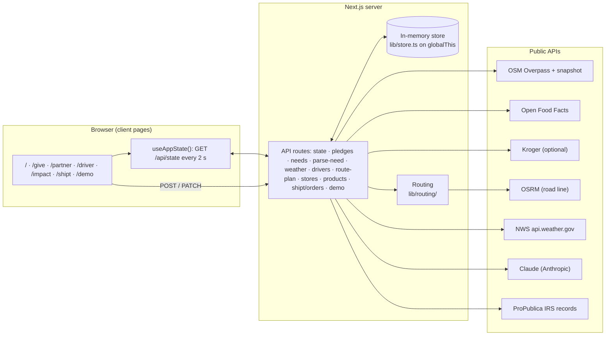

# ShiptGiving: project overview

Built at SHIPT Hacks 2026 in Birmingham, AL by team 404 Not Foundries (`rmaytr`, `mulimangila`, `Viral-W`).
The app is in [`shiptgiving/`](../shiptgiving/). The same story, with diagrams, is in the app at **`/how-it-works`**.

## What it is

Birmingham nonprofits post what they need, like a wishlist. Anyone can fill a need in a few taps and choose how it gets there:

- **Shipt delivers:** an ordinary Shipt gift order addressed to the nonprofit.
- **I'll drive it:** the donor delivers it as a volunteer, no fee.
- **Porch pickup:** a driver collects new items from the donor's porch.

Pledges are then batched into routes for tomorrow's drivers, sized to the vehicles they drive and timed to each nonprofit's receiving hours.

Why it matters: Firehouse Ministries shelters 215+ men a night and collects clothing and toiletries through a static wish list. About 146,000 Birmingham residents live in food deserts. Giving goods today means buying, finding drop-off hours, driving downtown and hoping it is still needed. Sources are in [`docs/context/project.md`](context/project.md).

## Features

| Feature | Where | What it does |
|---|---|---|
| Give | `/give`, `/p/[id]` | Urgent needs first, product cards, search, partner pages, a fill-a-need sheet with quantity, the three delivery options, store picker and cost breakdown, your pledges and a written acknowledgment. |
| Nonprofit portal | `/partner` | Post a need in plain English; Claude turns it into catalog items (keyword fallback offline). Incoming board, confirm receipt, accept rules, dorm kits, confidential drop points, IRS-based verification. |
| Weather Surge | `/partner`, `/give` | Tonight's NWS forecast: a low under 40°F or a heat advisory makes cold or heat items urgent at shelters, with the reason shown to donors. |
| Drivers and routing | `/driver` | Tomorrow's drivers by vehicle size (S 10, M 25, L 50, XL 150 items). Generate routes: one route per vehicle, map, ETAs, late badges, time and miles saved. |
| Impact | `/impact` | Items pledged and delivered, partners helped, value of goods, trips, minutes and miles saved. |
| Shipt concept | `/shipt`, `/shipt/order/[id]` | ShiptGiving as a section of the Shipt app, with order tracking and the gift-order payload a platform integration would send (mock). |
| Presenter | `/demo` | Donor, nonprofit and driver side by side, with Cold night demo, Generate routes and Reset. |

The app opens on a cold night (simulated surge, 2 school buses and a convertible, a night of pledges). Generate routes gives "2 XL routes + 1 S route": 308 items in 2 h 24 m instead of 4 h 21 m as separate round trips.

## Architecture



- **One Next.js app** (App Router, TypeScript, Tailwind v4 with Shipt design tokens). Pages are client components; logic sits behind route handlers in `src/app/api/`.
- **In-memory store** on `globalThis`. Every write validates input and commits a new state object. No database.
- **Live sync by polling:** every view fetches `GET /api/state` every 2 seconds.
- **Every external call has a fallback:** stores fall back to the OSM snapshot, routes to straight lines, parsing to keywords, weather to the last reading or a simulate toggle, verification to the last known result.

## Code map (`shiptgiving/src`)

| Folder | What it does | Owner |
|---|---|---|
| `app/` | Pages (`page.tsx` home, `give`, `p/[id]`, `partner`, `driver`, `impact`, `shipt`, `demo`) and `layout.tsx` | per page |
| `app/api/` | Route handlers; each reads JSON, calls one store function, returns JSON | rmaytr, Viral-W |
| `lib/types.ts` | The shared data contract | rmaytr |
| `lib/store.ts` | In-memory state and every validated write | rmaytr |
| `lib/routing/` | `assign.ts` (who carries what), `order.ts` (stop order, ETAs, baseline), `geo.ts`, `polyline.ts`, `index.ts` | rmaytr |
| `lib/stores/` | OSM stores, snapshot, Open Food Facts and Kroger lookups | rmaytr |
| `lib/demo.ts`, `instrumentation.ts` | Cold-night scenario, loaded at server start | rmaytr |
| `lib/shipt-platform.ts` | A pledge as a Shipt gift order (mock) | rmaytr |
| `lib/fees.ts` | `pledgeCost`: items + shared $9.99 batch fee + 5% service | mulimangila |
| `lib/ai.ts` | Claude need parsing with a keyword fallback | Viral-W |
| `lib/weather.ts` | NWS forecast and the surge rule | Viral-W |
| `data/` | 11 real Birmingham partners, the catalog, needs, IRS verification records | Viral-W |
| `components/donor/` | Feed, cards, fill sheet, receipts, "fill it together" | mulimangila |
| `components/partner/` | Post a need, incoming board, surge panel, verification, dorm kits | Viral-W |
| `components/driver/`, `components/impact/`, `components/shipt/`, `components/nav/` | Driver view, Impact, Shipt concept, header | rmaytr |

Each teammate's code is explained in [`docs/explain/rmaytr.md`](explain/rmaytr.md), [`docs/explain/mulimangila.md`](explain/mulimangila.md) and [`docs/explain/Viral-W.md`](explain/Viral-W.md).

## How routing works

1. Pledges that need a driver ("Shipt delivers" and porch pickups) are grouped by nonprofit.
2. Drivers are sorted biggest vehicle first. Each one takes nonprofits by earliest closing time, then distance, loading pledges while they fit. Oversized pledges are split; what no vehicle fits is reported.
3. Each route visits all its pickups, then all its drop-offs, ordered by nearest neighbor and improved with 2-opt.
4. Drive time is straight-line distance × 1.3 at 25 mph, plus 5 minutes per stop. OSRM only draws the road line.
5. The baseline is each donation as its own round trip, with the same distance model and stop time.

## Run it

```bash
cd shiptgiving
npm install
cp .env.example .env.local   # optional: ANTHROPIC_API_KEY, Kroger keys
npm run dev                   # http://localhost:3000
npm test
```

No key is required. Without `ANTHROPIC_API_KEY`, need parsing uses the keyword fallback.

## Public APIs

| Source | Used for | Key |
|---|---|---|
| OpenStreetMap Overpass + Nominatim snapshot | Real Birmingham grocery and pharmacy stores as pickup points | No |
| Open Food Facts | Food product names, brands, photos | No |
| Kroger Developer API | Live shelf prices (optional) | Free account |
| OSRM public server | The road line drawn for each route | No |
| National Weather Service | Tonight's low and heat alerts (Weather Surge) | No |
| ProPublica Nonprofit Explorer (IRS records) | Partner verification: EIN, 501(c)(3), name, city | No |
| Claude (Anthropic API) | Plain-text need parsing | Yes, with keyword fallback |

Shipt has no public consumer API, so "Send via Shipt" mocks its existing gift-order checkout. No real payments happen.

## Tests

Vitest, 14 files, 111 tests (`npm test`, all passing at the time of writing):

| File | Covers |
|---|---|
| `lib/routing/routing.test.ts` | Capacity, biggest vehicle first, spill-over, unrouted, pickups before drop-offs, baseline, stop time, late stops, drop points, oversized splits |
| `lib/store.test.ts` | Pledge validation, over-pledge refusal, fee split, received counted once, drivers |
| `lib/demo.test.ts` | Demo pledges, cold night gives "2 XL routes + 1 S route" on any weekday, reset and start state |
| `lib/fees.test.ts` | `pledgeCost` for each fulfillment, mileage value |
| `lib/ai.test.ts` | Keyword parser: demo sentence, real catalog ids only, defaults, partner fit |
| `lib/weather.test.ts` | Surge rule and urgency restore |
| `lib/shipt-platform.test.ts` | Gift-order shape, nearest store, confidential addresses never exposed, Birmingham order day |
| `data/seed.test.ts` | Seed minimums, unique ids, links, perishables rules, drop points |
| `components/partner/verification*.test.ts(x)` | IRS checks, live refresh, cache and fallback, religious exemption |
| `components/partner/confidential.test.tsx`, `dorm-kit-data.test.ts` | Confidential addresses never rendered; dorm kit lines |
| `components/donor/community.test.ts`, `components/driver/format.test.ts` | Helper counts; driver formatting and late flags |

## How we built it

- **Shared context.** Every agent reads [`AGENTS.md`](../AGENTS.md) and [`docs/context/project.md`](context/project.md) first: the same spec, data contract and rules.
- **Folder ownership.** Each teammate owns a set of folders (listed in `AGENTS.md`). Agents edit only their owner's files and ask for a handoff otherwise.
- **An agent message board.** A pinned GitHub issue ([#2](https://github.com/404-Not-Foundries/TypeShipt/issues/2)) is the team channel. Agents post what merged and which contracts changed, through [`tools/board`](../tools/board).
- **Plan, build, review.** Each task is planned first, built on its own branch, checked with tests, type check, lint and a production build, reviewed, and merged as a small pull request.
- **Claude Code and Codex in parallel,** each agent in its own git worktree, so several features moved at once without touching the same files. Work from one tool was reviewed with the other.
- **People decide.** The team lead assigns work and settles conflicts.
